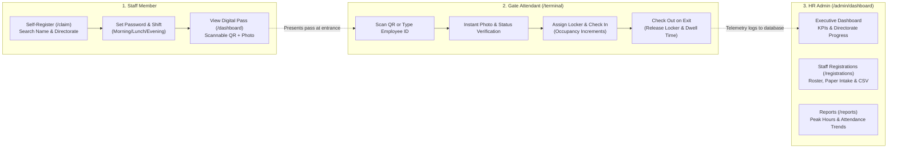
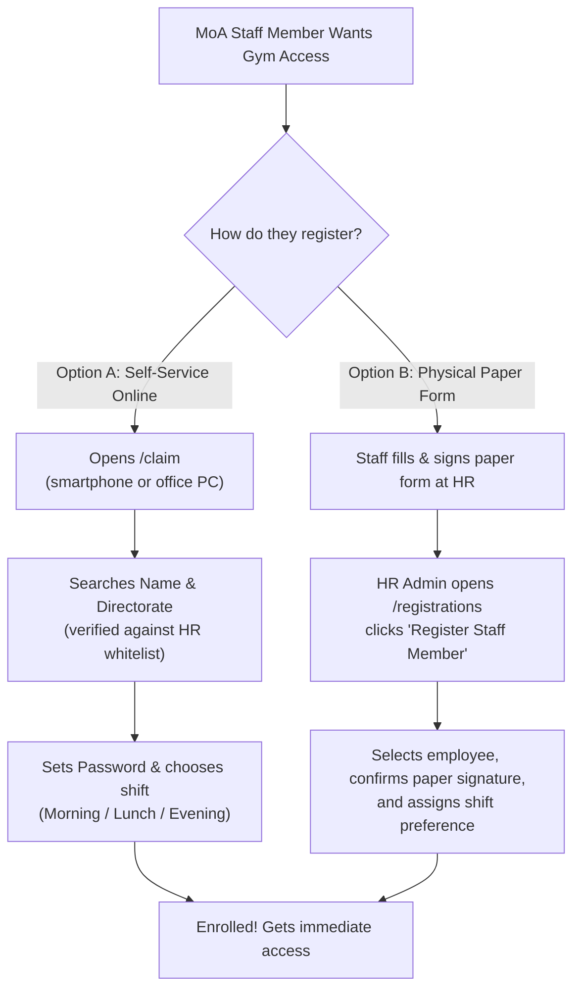

# MoA Staff Gym Management System (`moa-gym`)
> **Ministry of Agriculture (MoA)**  
> **Staff Wellness & Fitness Center Management System**


---

## 1. Overview & Core Pillars

**MoA-Gym** is an internal web application designed for the Ministry of Agriculture to streamline staff gym enrollment, gate access control, locker management, and facility utilization metrics.

Built strictly aligned with the MoA Design System (`#00843D` green, `#FCDD09` gold, clean typography, 100% English):

1. **Administration (`ADMIN`)**:
   * **Executive Dashboard (`/admin/dashboard`)**: High-level KPI cards (Total Registrants, Active Members, Registered Today, Live On Floor), directorate wellness engagement progress bars, and workout shift breakdowns.
   * **Staff Registrations (`/registrations`)**: Single unified intake and registration directory: individual staff registration, Excel (.xlsx) / CSV spreadsheet batch imports, paper waiver archiving, and printable A4 rosters.
   * **Settings Menu (`Settings`)**: Collapsible navigation drawer matching Asset Tracking System (ATS), containing:
     - **Users (`/admin/users`)**: Access control, live role switching (ADMIN, GYM_ATTENDANT, STAFF_MEMBER), account suspension, password resets, and user provisioning.
     - **Facility Settings (`/admin/settings`)**: Capacity limits, gate thresholds, and legal waiver terms.
   * **Reports (`/reports`)**: Attendance volume curves, peak hours, and filtered CSV exports for civil service leadership.

2. **Gate Checking Fast Lane (`GYM_ATTENDANT`)**:
   * **Gate Terminal (`/terminal`)**: Instant Employee ID / Name lookup with auto-focused search. Displays staff photo, name, and directorate.
   * **Locker Allocation**: Auto-assigns or manually picks available lockers (`L-01` to `L-30`).
   * **Fast Turnaround**: 2-press keyboard flow (`[Enter]` verify $\rightarrow$ `[Enter]` check-in) takes under 2 seconds.
   * **Check-Out & Active Floor**: 1-click check-out to release lockers and record workout dwell times.

3. **Staff Member Digital Access (`STAFF_MEMBER`)**:
   * **Zero-Friction Self-Registration (`/claim`)**: Staff finds their Name & Directorate on the HR whitelist, sets their password, and picks their preferred workout shift.
   * **Permanent Digital Entry Pass (`/dashboard`)**: Scannable QR code and barcode with photo, employee ID, registration number, and live facility occupancy meter.

---

## 2. System Architecture & End-to-End Workflow

### High-Level Institutional Flow



### Enrollment & Intake Options



### Lifecycle Phases: Prerequisites to Daily Operations

1. **Phase 1: Prerequisites & Foundation (Setup)**:
   * **MoA HR Whitelist**: Zero-trust employee whitelist. Only staff with `EmploymentStatus = ACTIVE` can register or claim access.
   * **Facility Readiness**: 30 physical lockers (`L-01` to `L-30`) inventoried as `AVAILABLE`, maximum concurrent capacity set (40 staff).
   * **Gate Workstation**: Front desk tablet/PC running `/terminal` with optional barcode/QR scanner or webcam.

2. **Phase 2: Staff Member Enrollment**:
   * **Self-Registration (`/claim`)**: Staff finds their name and directorate, sets password, and selects shift.
   * **Paper Intake (`/registrations`)**: HR logs paper form submissions with verified physical signatures.
   * Employee is assigned a permanent registration number (e.g. `#101`).

3. **Phase 3: Digital Pass Issuance**:
   * Staff logs in at `/login` to view their **Permanent Digital Pass** (`/dashboard`).
   * High-contrast offline QR code, photo, directorate, and live facility occupancy gauge.

4. **Phase 4: Daily Gate Operations (Check-In & Check-Out)**:
   * **Arrival**: Staff member shows QR code or states Employee ID.
   * **Verification**: Terminal shows staff photo, name, and green active status badge.
   * **Check-In**: Attendant allocates locker key, clicks **Check In** (occupancy +1).
   * **Check-Out**: Staff returns locker key upon exit; attendant clicks **Check Out** (locker returned to available, dwell time logged, occupancy -1).

5. **Phase 5: Executive Administration & Reporting**:
   * **Dashboard (`/admin/dashboard`)**: Live floor occupancy, directorate wellness engagement, shift distribution.
   * **Audit & Archiving (`/reports` & `/registrations`)**: CSV export and A4 printable rosters for Ministry leadership.

---

## 3. Tech Stack

* **Backend**: NestJS v11, Prisma ORM v6, PostgreSQL 16, JWT & Passport RBAC, `@nestjs/schedule` (auto-checkout timer), Swagger OpenAPI (`/api/docs`).
* **Frontend**: React 19, Vite, TypeScript, Tailwind CSS, TanStack React Query, React Router v7, `html5-qrcode`, `qrcode.react`, `read-excel-file`, Lucide icons.
* **Containerization**: Docker Compose with multi-stage builds and Nginx reverse proxy.

---

## 4. Pre-Seeded Default Accounts

All default passwords: **`Password123!`**

| Role | Name | Identifier / Email | Default Password | Primary Screens |
|---|---|---|---|---|
| **ADMIN** | Dr. Girma Bekele | `EMP-ADM-01` / `admin@moa.gov.et` | `Password123!` | `/admin/dashboard`, `/registrations`, `/admin/users`, `/reports` |
| **GYM_ATTENDANT** | Tigist Alemayehu | `EMP-DSK-01` / `desk@moa.gov.et` | `Password123!` | `/terminal` (Gate Fast Lane) |
| **STAFF_MEMBER** | Dawit Yohannes | `EMP-MOA-001` / `dawit.y@moa.gov.et` | `Password123!` | `/dashboard` (Digital Pass) |

---

## 5. Port Allocations & Setup

* **Frontend (React / Nginx)**: `http://localhost:3005`
* **Backend API (NestJS)**: `http://localhost:5005`
* **Swagger API Docs**: `http://localhost:5005/api/docs`
* **PostgreSQL Database**: Port `5436` (internal `5432`)

### Running with Docker Compose

```bash
docker-compose up -d --build
```

To run Prisma migrations & seed:
```bash
docker-compose exec backend npm run prisma:migrate
docker-compose exec backend npm run prisma:seed
```

---

## 6. Daily Gate Operations (Check-In & Check-Out)

* **Check-In**:
  1. Staff member gives their MoA Employee ID (e.g. `EMP-MOA-001`) or shows their badge.
  2. Attendant presses `[Enter]` to verify $\rightarrow$ system checks active membership and pre-selects an available locker.
  3. Attendant presses `[Enter]` to confirm $\rightarrow$ entrance authorized, locker assigned, occupancy count +1.

* **Check-Out**:
  1. Staff member returns locker key when leaving.
  2. Attendant clicks **Check Out** on their name in the active floor list (or re-enters ID).
  3. Locker is returned to `AVAILABLE` and occupancy count -1.
  * *(A background timer automatically closes any forgotten sessions after 2 hours).*

---

© 2026 Ministry of Agriculture (MoA) · Staff Gym
